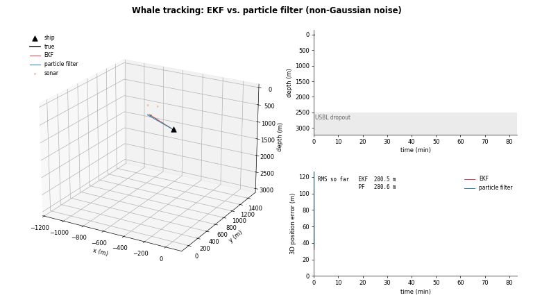

# Recursive Estimation for Whale Tracking

Programming exercise for *Recursive Estimation* (151-0566-00, ETH Zürich, Spring 2026).

A Cuvier's beaked whale dives to ~3000 m while a research ship tracks it with two sensors:

- **USBL acoustic telemetry**: horizontal position, noise grows linearly with depth
  (σ<sub>U</sub> = σ<sub>base</sub> + α z), complete dropout below z<sub>drop</sub> = 2500 m.
- **Active sonar**: full 3D position, noisier but available at all depths.

The whale follows a 9-state nonlinear model
x = [x, y, z, ψ, θ, p, r<sub>ψ</sub>, r<sub>θ</sub>, a] driven by a known behavioural
controller (dive, then ascend) plus random manoeuvres. Two estimators are implemented in
[`estimator.py`](estimator.py):

| Scenario | Estimator |
|---|---|
| Gaussian process and sensor noise | Extended Kalman Filter |
| Uniform process / USBL noise, bimodal Gaussian-mixture sonar noise | Bootstrap particle filter |

## Demo



Full-resolution video: [`media/demo.mp4`](media/demo.mp4)

Both filters track the same simulated dive under the **non-Gaussian** noise model. Top right:
depth with sonar returns and the USBL dropout zone. Bottom right: 3D position error over time.

## Approach

### Extended Kalman Filter

- **Initialisation** from the moments of the prior: uniform disk of radius R gives
  Var[x] = Var[y] = R²/4, uniform heading/pitch/speed give (b−a)²/12, depth and rates are known.
- **Prior update** through the nonlinear dynamics with the analytic Jacobian A(k−1). The dive
  schedule θ\*(k−1) is tracked with an internal time index. Depth clipping is ignored, as
  required by the specification.
- **Measurement update** with a linear H. The state-dependent USBL variance
  (σ<sub>base</sub> + α ẑ<sub>p</sub>)² is evaluated at the prior depth mean. During dropout
  (`np.nan`) only the three sonar rows are used.

### Particle filter (non-Gaussian case)

- 10 000 particles sampled from the exact initial distribution (uniform disk, uniform angles
  and speed).
- Propagation through the **full** nonlinear model including depth clipping, with uniform
  process noise U(−√3σ, √3σ).
- Weights from the **exact** likelihoods:
  - sonar: two-component Gaussian mixture 0.9·N(βσ<sub>S</sub>, (1−9β²)σ<sub>S</sub>²) + 0.1·N(−9βσ<sub>S</sub>, (1−9β²)σ<sub>S</sub>²) per axis;
  - USBL: uniform box of half-width √3 σ<sub>U</sub>(z) per particle, with a small floor so the
    filter cannot collapse when no particle is inside the support;
  - USBL availability itself is informative: a valid reading implies z < z<sub>drop</sub>, a
    dropout implies z ≥ z<sub>drop</sub>.
- Systematic resampling when N<sub>eff</sub> < N/2, followed by roughening to avoid sample
  impoverishment.
- Point estimate: weighted mean, circular mean for ψ and θ.
- Fully vectorised in NumPy.

## Results

Average over 30 randomised runs with the evaluation parameters (R, σ<sub>base</sub>, α,
σ<sub>S</sub>, ω<sub>yaw</sub>) drawn from their ranges in `const.py`, non-Gaussian noise:

| State | x | y | z | ψ | θ | p | r<sub>ψ</sub> | r<sub>θ</sub> | a |
|---|---|---|---|---|---|---|---|---|---|
| PF RMSE | 26.8 m | 23.3 m | 23.6 m | 0.99 rad | 0.18 rad | 0.44 m/s | 0.018 rad/s | 0.0045 rad/s | 0.0097 m/s² |
| PF / EKF | 0.58 | 0.51 | 0.63 | 0.69 | 0.96 | 0.85 | 0.51 | 0.96 | 0.81 |

The particle filter reduces the average per-state RMSE by about **28 %** compared with an EKF
run on the same non-Gaussian measurements. Most of the gain comes from position (it correctly
models the biased, heavy-tailed sonar noise) and heading (the initially uniform heading is a
strongly non-Gaussian prior).

Runtime per step (budgets: 5 ms EKF, 50 ms non-Gaussian estimator):

| Estimator | Time per step |
|---|---|
| EKF | ~0.06 ms |
| Particle filter | ~8 ms |

## Running

The simulator is provided as an obfuscated module that requires **Python 3.10** (x86-64).

With Docker (matches the grading environment, 4 cores / 2 GB RAM):

```bash
bash run.sh            # simulate, estimate, open interactive plots
bash run.sh headless   # save plot_3d.png, plot_ekf.png, plot_nge.png instead
```

Without Docker:

```bash
python3.10 -m venv .venv && .venv/bin/pip install -r requirements.txt
.venv/bin/python run.py --headless
```

Regenerate the demo video (needs `ffmpeg`):

```bash
.venv/bin/python media/make_video.py
```

`media/make_video.py` re-implements the whale and sensor models from the problem statement so
that ground truth is available for plotting. The course simulator does not expose it.

## Files

| File | Description |
|---|---|
| `estimator.py` | **EKF and particle filter implementation** |
| `media/make_video.py` | Ground-truth simulation and animation for the demo |
| `const.py`, `run.py`, `simulator.py`, `scoring.py`, `plotting.py`, `plot_results.py`, `run.sh`, `run.bat`, `Dockerfile`, `entrypoint.sh` | Exercise framework provided by the course |
